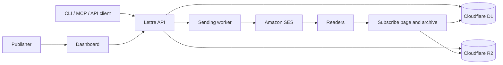

<div align="center">
  
  <h1>Lettre</h1>
  <p><strong>Your newsletter, on your infrastructure.</strong></p>
  <p>Lettre is LetRetro’s open-source, self-hosted newsletter platform for writing, sending, and managing newsletters on your own infrastructure.</p>
  <p>
    <a href="https://github.com/LetRetroHQ/lettre/actions/workflows/ci.yml"></a>
    <a href="LICENSE"></a>
    <a href="https://nodejs.org/"></a>
    <a href="https://bun.sh/"></a>
    <a href="https://github.com/LetRetroHQ"></a>
  </p>
  <p><a href="#try-it-locally">Try locally</a> · <a href="docs/README.md">Self-hosting guide</a> · <a href="docs/publishing/README.md">Publishing guide</a> · <a href="CONTRIBUTING.md">Contributing</a></p>
</div>

---

## A direct line to your readers

Lettre runs in your own Cloudflare account and sends through Amazon SES. Your subscriber list, content, delivery history, and archive stay in infrastructure you control. You pay your infrastructure providers directly; Lettre does not charge a platform subscription.

- **Write and publish:** draft in Markdown, preview and test an email, then schedule it with a review window.
- **Own your list:** collect double opt-ins, import and export subscribers, and manage unsubscribes and suppressions.
- **Follow delivery:** see send progress and provider events, including bounces and complaints.
- **Give posts a home:** share a public archive and subscription page branded for your publication.
- **Work your way:** use the dashboard, HTTP API, CLI, or an MCP-compatible client such as Claude.

The dashboard uses the Lettre mark, Phosphor icons, and locally hosted Gabarito typography. It follows your system’s light or dark theme until you choose one in the sidebar.

## Try it locally

You need [Node.js 22 or later](https://nodejs.org/), [Bun 1.4.2](https://bun.sh/), and Git.

```bash
git clone https://github.com/LetRetroHQ/lettre.git
cd lettre
bun install
cp .dev.vars.example .dev.vars
bun run dev
```

Open [localhost:8787/dashboard/](http://localhost:8787/dashboard/) for the editor or [localhost:8787/](http://localhost:8787/) for the public homepage. The development server applies the local database migrations when needed. Local email goes to a simulated outbox, not real inboxes.

To explore **Lettre Journal**, the sample publication, keep the server running and use another terminal:

```bash
bun run seed
```

Seeding replaces the local database contents with demo data. `bun run reset` clears that local data. See [the demo guide](demo/README.md) to customize the sample.

## Self-host Lettre

A deployed instance uses Cloudflare Workers, D1, R2, and Access, plus Amazon SES for email. Start with the [self-hosting guide](docs/README.md), which walks through creating an instance, connecting your domain and email provider, testing delivery, and going live. Cloudflare and AWS costs depend on your usage and plans.

The [publishing guide](docs/publishing/README.md) covers writing, managing your list, and sending newsletters. The dashboard also includes the guides and an API reference.

## How it fits together



Cloudflare Access protects the dashboard and authoring API. The public pages handle reader-facing subscription and archive requests. SES delivers email and reports delivery events back to Lettre.

## Develop

```bash
bun run typecheck      # Generate Worker types and check TypeScript
bun run test           # Run the test suite
bun run ci             # Check formatting and lint rules
bun run check:package  # Validate the packaged app in a scratch instance
```

The [contribution guide](CONTRIBUTING.md) covers local development and pull requests. GitHub Actions runs type checking, tests, and linting on pushes.

## Documentation

| I want to… | Start here |
| --- | --- |
| Deploy and operate Lettre | [Self-hosting](docs/README.md) |
| Write and send a newsletter | [Publishing](docs/publishing/README.md) |
| Configure an instance | [Configuration reference](docs/reference/01-configuration.md) |
| Explore the API and behavior | [API reference](docs/API.md) · [Specification](docs/SPEC.md) |
| Understand the interface | [Design guide](docs/DESIGN.md) |
| Contribute to Lettre | [Contributing](CONTRIBUTING.md) |

## License

Lettre is open source under the [MIT License](LICENSE). Built by [LetRetro](https://github.com/LetRetroHQ).
