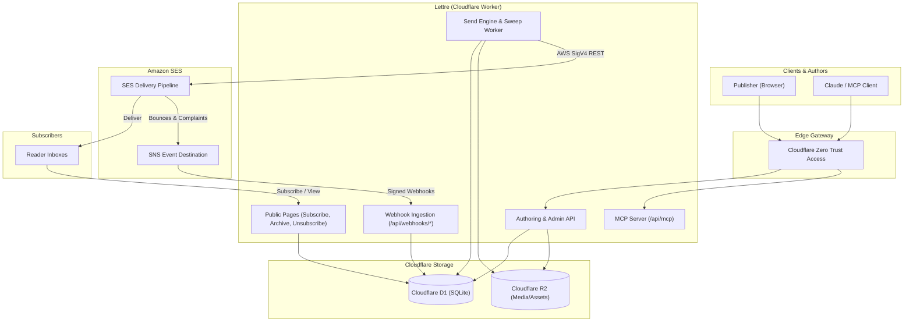

# Lettre

[](LICENSE)
[](https://github.com/LetRetroHQ)

Lettre by LetRetro is an open-source, self-hosted newsletter management and email delivery platform built on Cloudflare Workers, Cloudflare D1, Cloudflare R2, and Amazon Simple Email Service (SES).

With Lettre, you maintain complete ownership of your subscriber list, opt-in audit provenance, delivery history, media assets, and public archive—without monthly platform fees or vendor lock-in.

---

## Table of Contents

1. [Overview](#1-overview)
2. [Platform Capabilities](#2-platform-capabilities)
3. [Key Features](#3-key-features)
4. [Technology Stack](#4-technology-stack)
5. [System Architecture](#5-system-architecture)
6. [Newsletter Sending Workflow](#6-newsletter-sending-workflow)
7. [Cloudflare Infrastructure](#7-cloudflare-infrastructure)
8. [Amazon SES Integration](#8-amazon-ses-integration)
9. [Local Development Setup](#9-local-development-setup)
10. [Environment Variables & Configuration](#10-environment-variables--configuration)
11. [Database Initialization & Migrations](#11-database-initialization--migrations)
12. [Media Storage Setup](#12-media-storage-setup)
13. [Email Provider Setup](#13-email-provider-setup)
14. [Deployment Instructions](#14-deployment-instructions)
15. [Troubleshooting & Diagnostics](#15-troubleshooting--diagnostics)
16. [Contributing](#16-contributing)
17. [License](#17-license)

---

## 1. Overview

**Lettre** is designed for independent publishers, engineering teams, and organizations seeking an enterprise-grade newsletter infrastructure with zero ongoing platform subscription costs.

Unlike hosted third-party newsletter services, Lettre runs directly within your own cloud account:
- **Direct Infrastructure Costs**: You pay Cloudflare and Amazon SES directly at utility rates (fractions of a cent per email).
- **Absolute List Ownership**: Subscriber records, cryptographic opt-in timestamps, and suppression lists remain in your private database.
- **Dual Interface**: Operate seamlessly through a modern, responsive web dashboard or automate campaigns programmatically via the REST API and Model Context Protocol (MCP) using AI tools like Claude.

---

## 2. Platform Capabilities

- **Authoring & Formatting**: Write articles using standard GitHub Flavored Markdown with inline image support and real-time live preview.
- **Campaign Management**: Schedule broadcasts with configurable review windows, cancel or reschedule sends, and test deliveries before firing.
- **List Growth & Verification**: Double opt-in confirmation flows with anti-tamper verification tokens and spam-resistant submission throttles.
- **Delivery Intelligence**: Real-time delivery reconciliation, rate-limited batch dispatching, bounce classification, and automated complaint suppression.
- **Reader Experience**: Hosted web archive, responsive email rendering across major email clients, automated plain-text alternative generation, and one-click unsubscription.
- **Automation & Extensibility**: Full REST API coverage, Model Context Protocol (`/api/mcp`) integration, and CLI tool (`lettre`).

---

## 3. Key Features

### Markdown Editor with Dual Preview
- Real-time side-by-side editing and HTML email preview.
- Drag-and-drop media uploads directly stored in Cloudflare R2.
- Autosave and revision history tracking.
- Automated generation of multipart MIME plain-text alternatives.

### Workspace design
- A LetRetro-inspired, warm monochrome interface with Phosphor icons and the Lettre mark.
- Gabarito is self-hosted for interface text and headings; JetBrains Mono is used for technical text.
- The public homepage uses the same locally hosted Gabarito typography and neutral design while showing your publication’s identity and archive.
- The dashboard follows your system’s light or dark theme until you choose a mode in the sidebar. The public homepage follows the reader’s system theme.
- Local demo data uses the Lettre Journal identity and logo. Run `bun run seed` while the local server is running to load it; seeding replaces the local demo database.

### Campaign Scheduling & Safety Review Window
- Configurable scheduling lead times prevent accidental immediate dispatches.
- Live countdown with one-click cancellation and rescheduling.
- Send test emails of the exact frozen campaign payload prior to release.

### Subscriber & Suppression Management
- Strict double opt-in verification ensuring compliant subscriber acquisition.
- Fast bulk import and export with provenance tracking.
- Immediate bounce and complaint suppression prevents sending reputation degradation.
- Manual address blocking and suppression lifting with safety checks.

### AI Agent Support via MCP
- Native Model Context Protocol (MCP) server at `POST /api/mcp`.
- Connect Claude Desktop or Claude Code directly to draft posts, inspect send metrics, and schedule issues.
- Zero Trust Access authentication ensures secure agent interactions.

---

## 4. Technology Stack

| Layer | Component | Description |
|---|---|---|
| **Edge Compute** | Cloudflare Workers | Serverless edge execution with V8 isolates (`nodejs_compat`). |
| **Relational Database** | Cloudflare D1 | Distributed SQLite database for application state, campaigns, and logs. |
| **Media Storage** | Cloudflare R2 | S3-compatible zero-egress object storage for uploaded images and logos. |
| **Scheduled Worker** | Cloudflare Cron Triggers | Automated once-per-minute (`* * * * *`) dispatch sweep. |
| **Security & Auth** | Cloudflare Zero Trust Access | Identity-aware proxy, OAuth 2.0 PKCE, and JWT verification. |
| **Email Delivery** | Amazon SES | High-throughput SMTP/REST email sending with AWS SigV4 authentication. |
| **Frontend SPA** | Vanilla TypeScript & HTML | Zero-framework, high-speed lightweight client with CSS design tokens. |
| **CLI & Automation** | Node.js 22+ CLI | `lettre` command-line utility for local development and remote operations. |

---

## 5. System Architecture

The following diagram illustrates the interaction between publishers, AI clients, Cloudflare edge services, Amazon SES, and subscribers:



---

## 6. Newsletter Sending Workflow

1. **Drafting**: The publisher drafts content in Markdown. Images are uploaded to Cloudflare R2 and given immutable URLs.
2. **Scheduling**: Setting a target send time places the campaign in the review window. All parameters (recipient query, subject, template, and content) freeze.
3. **Pre-flight Testing**: The publisher dispatches a test to verify formatting across email clients.
4. **Scheduled Execution**: Every minute, Cloudflare Cron Triggers execute the send sweep:
   - Identify due campaigns in Cloudflare D1.
   - Stream confirmed, non-suppressed subscribers in chunks.
   - Inject per-recipient tokens (`{{ .Email.UnsubscribeURL }}`).
   - Send requests to Amazon SES using rate-limited concurrent batches.
5. **Reconciliation & Telemetry**:
   - Deliveries, bounces, and complaints stream into webhook endpoints.
   - If an unexpected network interruption occurs, ambiguous recipients are marked for manual resolution (`Assume sent` or `Assume not sent`).
6. **Archive Publication**: The post immediately becomes available in the public archive.

---

## 7. Cloudflare Infrastructure

The platform leverages Cloudflare's serverless primitives:

- **Cloudflare Workers**: Powers both the dynamic JSON REST API and static asset delivery.
- **Cloudflare D1**: Manages schema migrations and transactional queries for subscribers, deliveries, campaign metadata, and settings.
- **Cloudflare R2**: Hosts uploaded images and static assets without egress bandwidth charges.
- **Cloudflare Cron Triggers**: Executes scheduled background tasks once per minute (`* * * * *`).
- **Cloudflare Zero Trust Access**: Protects `/dashboard/` and `/api/*` behind enterprise identity authentication (Google Workspace, GitHub, Okta, or one-time pin).

---

## 8. Amazon SES Integration

Lettre connects to Amazon SES directly via AWS Signature Version 4 (SigV4) HTTP requests, eliminating bulky SDK overhead:

- **Identity Verification**: Requires a verified domain identity in your selected AWS region.
- **Configuration Sets**: Bounces and complaints route through an SES Configuration Set with an SNS event destination pointing to Lettre's webhook.
- **Sandbox Compliance**: The dashboard monitors whether your AWS account is in the SES Sandbox or has Production Access, displaying actionable guidance in Settings.

---

## 9. Local Development Setup

### Prerequisites
- [Node.js](https://nodejs.org/) v22.0.0 or higher
- [Bun](https://bun.sh/) v1.4.2 or higher

### Step-by-Step Setup

1. **Clone the repository and install dependencies**:
   ```bash
   git clone https://github.com/LetRetroHQ/lettre.git
   cd lettre
   bun install
   ```

2. **Configure local environment variables**:
   ```bash
   cp .dev.vars.example .dev.vars
   ```

3. **Start the local development server**:
   ```bash
   bun run dev
   ```
   Open your browser to `http://localhost:8787/dashboard/`.

4. **Load sample demo data**:
   In a separate terminal window, populate the local instance with sample posts, subscribers, and send records:
   ```bash
   bun run seed
   ```

5. **Simulate scheduled sends**:
   ```bash
   bun run simulate-send --in 60s
   ```

6. **Reset local database**:
   ```bash
   bun run reset
   ```

---

## 10. Environment Variables & Configuration

The application is configured through environment variables in `wrangler.jsonc` (for non-sensitive settings) and Cloudflare Secrets (for credentials).

### Application Variables

| Variable | Required | Description | Example |
|---|---|---|---|
| `APP_ORIGIN` | Yes | Canonical public URL of the application. | `https://newsletter.example.com` |
| `FROM_ADDRESS` | Yes | Sender name and address for emails. | `Lettre <newsletter@send.example.com>` |
| `SENDING_DOMAIN` | Yes | Domain verified in Amazon SES. | `send.example.com` |
| `AWS_REGION` | Yes | AWS region hosting SES. | `us-east-1` |
| `PROVIDER` | Yes | Provider type (`ses` in production, `fake` in local dev). | `ses` |
| `ARCHIVE_ORIGIN` | No | Alternative origin for the public archive. | `https://example.com` |
| `ARCHIVE_BASE_PATH` | No | Base path for archived newsletters. | `/archive` |
| `NOTIFY_FROM` | No | Notification sender address. | `Lettre <letretro@example.com>` |
| `SUBREQUEST_BUDGET`| No | Maximum subrequests per cron tick (default: 50). | `50` |

### Production Secrets

Set via `bunx wrangler secret put <NAME> --env production`:

| Secret | Description |
|---|---|
| `AWS_ACCESS_KEY_ID` | IAM access key with permissions to send emails via SES. |
| `AWS_SECRET_ACCESS_KEY` | Secret access key corresponding to the IAM key. |
| `SES_CONFIGURATION_SET` | Name of the SES configuration set handling webhooks. |
| `ACCESS_TEAM_DOMAIN` | Cloudflare Zero Trust team domain (e.g., `company.cloudflareaccess.com`). |
| `ACCESS_AUD` | Application Audience (AUD) tag generated by Cloudflare Access. |

---

## 11. Database Initialization & Migrations

Lettre uses Cloudflare D1 for state persistence. Migrations reside in the `migrations/` directory.

### Running Migrations Locally
```bash
bunx wrangler d1 migrations apply DB --local
```

### Running Migrations in Production
```bash
bunx wrangler d1 migrations apply DB --remote --env production
```

### Checking Migration Status
```bash
bun bin/lettre.mjs sync-migrations
```

---

## 12. Media Storage Setup

1. **Create an R2 bucket**:
   ```bash
   bunx wrangler r2 bucket create letretro-media-production
   ```

2. **Bind the bucket in `wrangler.jsonc`**:
   ```jsonc
   "r2_buckets": [
     {
       "binding": "MEDIA",
       "bucket_name": "letretro-media-production"
     }
   ]
   ```

3. **Public Access**: Media URLs are served directly via the Worker's media routes with cache headers.

---

## 13. Email Provider Setup

### 1. Verify Domain in Amazon SES
1. Navigate to the AWS SES Console.
2. Under **Configuration** → **Identities**, select **Create identity** and choose **Domain**.
3. Add the generated DNS records (DKIM, SPF, and MX) to your DNS provider.

### 2. Configure Event Webhooks
1. Create an SES Configuration Set (e.g., `letretro-mail`).
2. Add an **Event destination** using Amazon SNS.
3. Configure an HTTPS subscription in SNS pointing to:
   ```
   https://newsletter.example.com/api/webhooks/ses
   ```
4. Lettre automatically confirms the SNS topic subscription handshake.

---

## 14. Deployment Instructions

1. **Log in to Cloudflare**:
   ```bash
   bunx wrangler login
   ```

2. **Create the production D1 database**:
   ```bash
   bunx wrangler d1 create letretro-production
   ```
   Copy the output `database_id` into `template/wrangler.jsonc` under `env.production.d1_databases`.

3. **Deploy the Worker**:
   ```bash
   bunx wrangler deploy --env production
   ```

4. **Attach Custom Domain**:
   Configure your custom domain in the Cloudflare Dashboard under **Workers & Pages** → **Settings** → **Domains & Routes**.

5. **Protect with Cloudflare Access**:
   - Go to **Cloudflare Zero Trust** → **Access** → **Applications**.
   - Create an application protecting `newsletter.example.com/dashboard*` and `newsletter.example.com/api*`.
   - Set policies permitting authorized administrators.

---

## 15. Troubleshooting & Diagnostics

- **Health Check**: Call `GET /health` to verify database migrations and configuration readiness:
  ```bash
  curl -i https://newsletter.example.com/health
  ```
  Expected: `{"status":"ok","service":"letretro"}`.

- **AWS SES Refusal (403)**:
  - Verify your `AWS_ACCESS_KEY_ID` and `AWS_SECRET_ACCESS_KEY` secrets.
  - Ensure the IAM user policy grants `ses:SendEmail` and `ses:SendRawEmail`.

- **Webhooks Not Arriving**:
  - Check the SNS subscription status in the AWS Console.
  - Review Worker tail logs for incoming requests:
    ```bash
    bunx wrangler tail --env production
    ```

- **Wedged or Ambiguous Sends**:
  - Open the campaign record in the dashboard.
  - Click **Resolve Ambiguous Deliveries** and select **Assume not sent** (safest default) or **Assume sent**.

---

## 16. Contributing

We welcome contributions from the community!

### Quality Gate Requirements
Before submitting a pull request, ensure all tests and linters pass:

```bash
bun run typecheck    # TypeScript verification across worker and client
bun run test             # Full Vitest suite
bun run check        # Biome formatting and lint check
```

For detailed guidelines, see [CONTRIBUTING.md](CONTRIBUTING.md).

---

## 17. License

Lettre is open source software licensed under the [MIT License](LICENSE).
